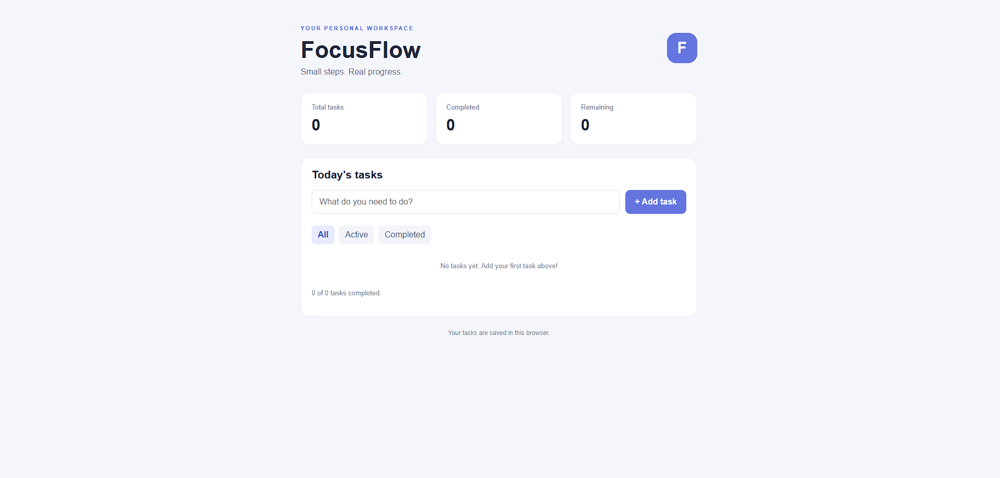

# FocusFlow — Daily Task Manager

## Preview



[**Live Demo →**](https://ahmedadj404-create.github.io/focusflow/)


**FocusFlow** is a simple, lightweight daily task manager built with HTML, CSS, and JavaScript. It helps users organize their daily tasks, track completed work, and stay focused on what matters.

🌐 **Live Demo:** [Try FocusFlow](https://ahmedadj404-create.github.io/focusflow/)

## ✨ Features

- **Add Tasks** — Create tasks with a simple input field.
- **Complete Tasks** — Mark tasks as completed when you finish them.
- **Delete Tasks** — Remove tasks you no longer need.
- **Filter Tasks** — View all, active, or completed tasks.
- **Task Statistics** — Track total, completed, and remaining tasks.
- **Automatic Saving** — Store tasks in your browser using LocalStorage.
- **Responsive Design** — Use the application on desktop and mobile screens.
- **No Installation Required** — Open the live website and start organizing your day.

## 🛠️ Built With

- **HTML5** — Page structure and content.
- **CSS3** — Layout, styling, and responsive design.
- **JavaScript** — Task management and interactive features.
- **LocalStorage** — Saving tasks locally in the browser.
- **GitHub Pages** — Hosting the live website.

## 🚀 Getting Started

### Use FocusFlow Online

Visit the live application:

**https://ahmedadj404-create.github.io/focusflow/**

No account or installation is required.

### Run Locally

1. Clone the repository:

   ```bash
   git clone https://github.com/ahmedadj404-create/focusflow.git
   ```

2. Open the project folder:

   ```bash
   cd focusflow
   ```

3. Open `index.html` in your web browser.

You can also open the folder in Visual Studio Code to explore or modify the source code.

## 📂 Project Structure

```text
focusflow/
├── index.html    # Application structure
├── style.css     # Styling and responsive layout
├── script.js     # Task management logic
└── README.md     # Project documentation
```

## 💾 Data Storage

FocusFlow uses your browser's LocalStorage to save tasks between visits.

- Tasks are stored locally in the browser.
- No backend server or database is required.
- Tasks do not automatically sync across different devices or browsers.
- Clearing the browser's stored site data may remove saved tasks.

## 🎯 Project Goals

FocusFlow is a beginner-friendly project created to explore web development fundamentals, including HTML structure, CSS styling, JavaScript interactions, browser storage, and deployment with GitHub Pages.

Future improvements may include task priorities, due dates, dark mode, and automated tests.

## 🤝 Contributing

Contributions, suggestions, and bug reports are welcome.

1. Fork this repository.
2. Create a branch for your changes.
3. Make and test your improvements.
4. Submit a pull request describing your changes.

For significant changes, consider opening an issue first to discuss the proposed improvement.

## 📄 License

No license has been added to this repository yet. Until a license is provided, the code remains subject to the default copyright rules. A license should be added before explicitly permitting others to reuse, modify, or redistribute the project.

---

**Built as a learning project with a focus on simplicity, usability, and continuous improvement.**
